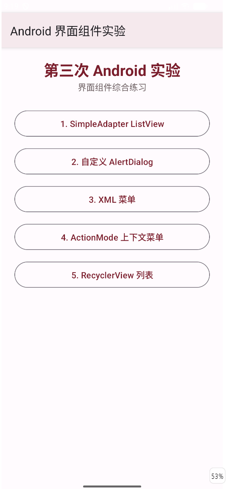
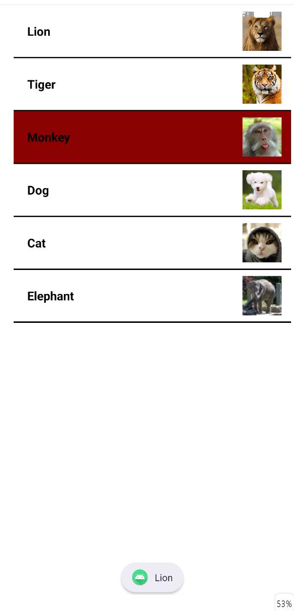
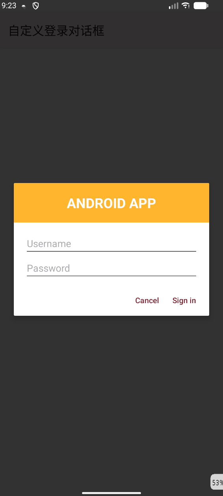
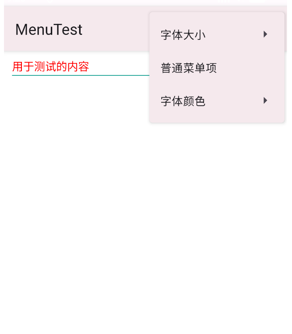
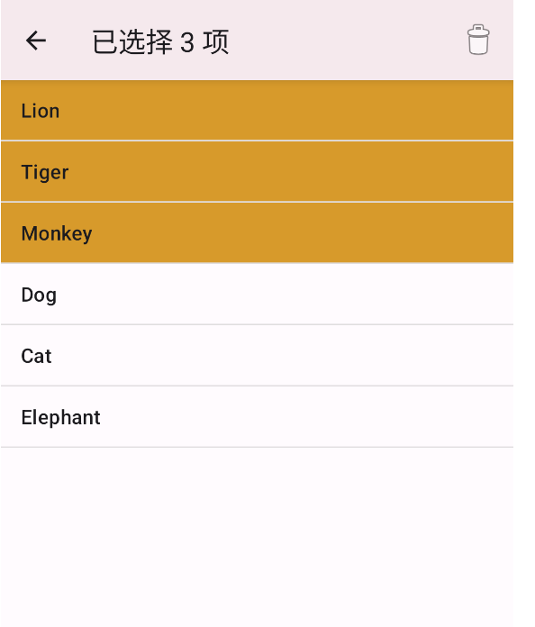
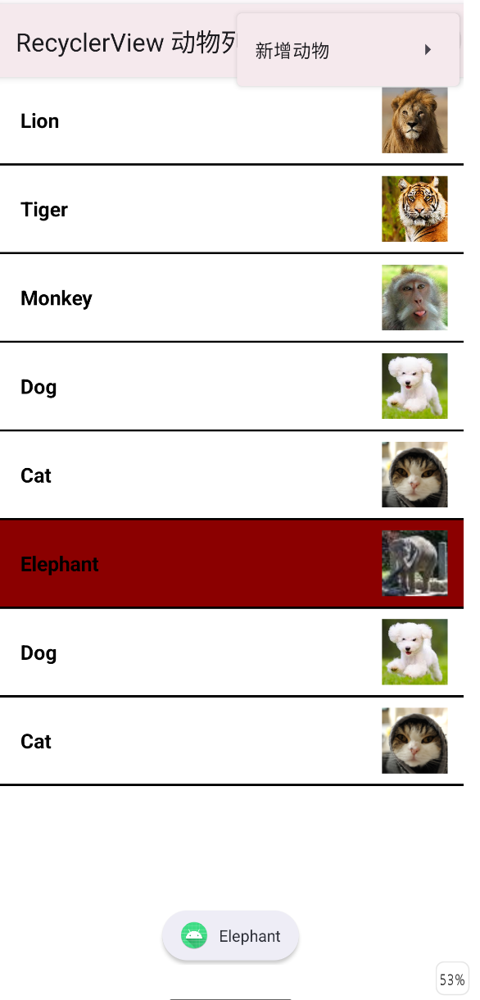

# 移动软件开发实验报告

## 实验三：Android 界面组件

### 一、实验目的

1. 掌握 Android `ListView` 的基本使用方法，理解列表数据、列表项布局和 Adapter 之间的关系。
2. 掌握使用 `SimpleAdapter` 将文字与图片数据绑定到自定义列表项的方法。
3. 掌握 `Toast` 与系统通知的创建和显示方法。
4. 掌握使用 `AlertDialog.Builder` 和自定义 XML 布局创建对话框的方法。
5. 掌握在 `res/menu` 目录中使用 XML 定义选项菜单和上下文操作菜单的方法。
6. 掌握通过菜单事件动态修改文字大小和颜色的方法。
7. 掌握 ActionMode 上下文操作模式及列表多选、批量删除的实现方法。
8. 掌握 `RecyclerView`、Adapter 和 ViewHolder 的基本使用方法。
9. 学会组织多个 Activity，并使用主页面按钮在不同实验页面之间进行导航。

### 二、实验内容

根据《实验3_Android界面组件.pdf》的要求，本次实验完成以下内容：

- 创建实验主页面，使用五个按钮分别进入五个界面组件实验。
- 使用 `ListView`、`SimpleAdapter` 和自定义列表项 XML 显示六种动物的名称与图片。
- 单击动物列表项后，将选中项背景设置为深红色，使用 Toast 显示动物名称，并发送标题为动物名称的系统通知。
- 使用自定义 XML 布局和 `AlertDialog.Builder.setView()` 创建登录对话框。
- 使用 XML 定义 `MenuTest` 页面的菜单，实现 10sp、16sp、20sp 三种字号切换、普通菜单项 Toast 提示以及红色、黑色两种字体颜色切换。
- 使用 ActionMode 实现动物名称列表的直接多选和批量删除，单击列表项即可选择，无需长按。
- 使用 `RecyclerView`、Adapter 与 ViewHolder 显示动物列表。
- RecyclerView 列表单击后显示动物名称并将选中项变为深红色；通过右上角 XML 菜单选择要新增的动物。
- 对 Gradle 配置、资源引用、Java 源码和 XML 文件进行编译与静态检查。

### 三、实验环境

| 环境或工具 | 配置 |
| --- | --- |
| 操作系统 | Windows |
| 开发工具 | Android Studio |
| 开发语言 | Java、XML |
| UI 技术 | Android View、AppCompat、Material 3 |
| Android Gradle Plugin | 9.3.3 |
| Gradle | 9.5.0 |
| Gradle JVM / JDK | JDK 25 |
| Java 源码兼容版本 | Java 11 |
| Compile SDK / Target SDK | API 37 |
| Min SDK | API 24 |
| AppCompat | 1.6.1 |
| RecyclerView | 1.3.2 |
| ConstraintLayout | 2.2.2 |
| 测试方式 | Gradle Debug 构建、Android Lint、模拟器或真机运行 |

### 四、实验过程

#### 1. 分析实验要求并规划工程结构

首先阅读《实验3_Android界面组件.pdf》，将实验拆分为 ListView、自定义 AlertDialog、XML 菜单、ActionMode 和 RecyclerView 五个功能模块。每个小实验使用独立 Activity 和独立 XML 布局，主页面通过按钮启动对应 Activity。

项目中与本实验直接相关的主要文件结构如下：

```text
third_android_app/
├── app/
│   ├── build.gradle.kts
│   └── src/main/
│       ├── AndroidManifest.xml
│       ├── java/com/example/third_android_app/
│       │   ├── MainActivity.java
│       │   ├── AnimalData.java
│       │   ├── ListViewActivity.java
│       │   ├── DialogActivity.java
│       │   ├── MenuActivity.java
│       │   ├── ActionModeActivity.java
│       │   └── RecyclerViewActivity.java
│       └── res/
│           ├── drawable/
│           │   ├── animal_row_background.xml
│           │   └── recycler_divider.xml
│           ├── drawable-nodpi/
│           │   ├── lion.jpeg
│           │   ├── tiger.jpg
│           │   ├── monkey.jpeg
│           │   ├── dog.jpeg
│           │   ├── cat.png
│           │   └── elephant.jpg
│           ├── layout/
│           │   ├── activity_main.xml
│           │   ├── activity_list_view.xml
│           │   ├── row_animal.xml
│           │   ├── activity_dialog.xml
│           │   ├── dialog_login.xml
│           │   ├── activity_menu.xml
│           │   ├── activity_action_mode.xml
│           │   └── activity_recycler.xml
│           ├── menu/
│           │   ├── menu_text_options.xml
│           │   ├── menu_action_mode.xml
│           │   └── menu_add_animal.xml
│           └── values/
│               ├── colors.xml
│               ├── strings.xml
│               ├── styles.xml
│               └── themes.xml
├── gradle/libs.versions.toml
└── README.md
```

动物名称和图片资源编号统一保存在 `AnimalData.java` 中，避免在 ListView 和 RecyclerView 两个实验中重复编写同一组数据。

#### 2. 配置依赖与网络镜像

实验五使用 RecyclerView，因此在版本目录中声明 RecyclerView 依赖：

```toml
[versions]
recyclerview = "1.3.2"

[libraries]
recyclerview = {
    group = "androidx.recyclerview",
    name = "recyclerview",
    version.ref = "recyclerview"
}
```

App 模块通过版本目录引用依赖：

```kotlin
dependencies {
    implementation(libs.appcompat)
    implementation(libs.material)
    implementation(libs.recyclerview)
}
```

项目同步过程中出现了网络连接超时。为提高依赖下载的稳定性，在 `settings.gradle.kts` 中为插件和普通依赖配置阿里云镜像，同时保留 Google、Maven Central 和 Gradle Plugin Portal 作为备用仓库。Gradle Wrapper 使用腾讯云镜像下载 Gradle 9.5.0。

#### 3. 创建主页面并实现按钮导航

`MainActivity` 是应用唯一的启动入口。`activity_main.xml` 中放置五个按钮，分别代表五个小实验。按钮点击后通过显式 Intent 启动对应 Activity：

```java
findViewById(R.id.button_listview)
        .setOnClickListener(v -> open(ListViewActivity.class));
findViewById(R.id.button_dialog)
        .setOnClickListener(v -> open(DialogActivity.class));
findViewById(R.id.button_menu)
        .setOnClickListener(v -> open(MenuActivity.class));
findViewById(R.id.button_action_mode)
        .setOnClickListener(v -> open(ActionModeActivity.class));
findViewById(R.id.button_recycler)
        .setOnClickListener(v -> open(RecyclerViewActivity.class));
```

页面布局、按钮文字和按钮样式均在 XML 资源中定义，Java 代码只负责监听点击并完成页面跳转。

#### 4. 使用 SimpleAdapter 实现动物 ListView

实验一的列表项布局定义在 `row_animal.xml` 中。每行左侧是动物名称，右侧是动物图片；列表使用白色背景和黑色分隔线，外观与实验示例图一致。

数据源使用 `List<Map<String, Object>>` 保存。每条记录包含 `name` 和 `image` 两个字段，`SimpleAdapter` 将这两个字段分别绑定到 `TextView` 和 `ImageView`：

```java
SimpleAdapter adapter = new SimpleAdapter(
        this,
        rows,
        R.layout.row_animal,
        new String[]{"name", "image"},
        new int[]{R.id.animal_name, R.id.animal_image}
);
listView.setAdapter(adapter);
```

列表使用单选模式。单击某一项后调用 `setItemChecked()` 保存选中状态，`animal_row_background.xml` 根据 `state_activated` 将选中项背景切换为深红色：

```xml
<selector xmlns:android="http://schemas.android.com/apk/res/android">
    <item android:state_activated="true">
        <color android:color="#8B0000" />
    </item>
    <item>
        <color android:color="@color/white" />
    </item>
</selector>
```

单击事件还会使用 Toast 显示动物名称，并调用 `showAnimalNotification()` 发送通知。

#### 5. 创建动物选择通知

Android 8.0 及以上版本发送通知前需要创建通知渠道。本实验使用 `animal_selection` 作为渠道 ID：

```java
if (Build.VERSION.SDK_INT >= Build.VERSION_CODES.O) {
    NotificationChannel channel = new NotificationChannel(
            CHANNEL_ID,
            getString(R.string.notification_channel),
            NotificationManager.IMPORTANCE_DEFAULT
    );
    getSystemService(NotificationManager.class)
            .createNotificationChannel(channel);
}
```

Android 13 及以上版本还需要动态申请 `POST_NOTIFICATIONS` 权限。获得权限后，通知标题使用所选动物名称，通知内容为空，通知图标使用应用图标。点击通知后重新进入动物列表页面。

#### 6. 使用自定义布局创建 AlertDialog

第二个小实验的自定义对话框布局保存在 `dialog_login.xml` 中，包含橙色标题区域、用户名输入框和密码输入框。Activity 使用 `LayoutInflater` 加载布局，再通过 `AlertDialog.Builder.setView()` 将布局加入对话框：

```java
View content = LayoutInflater.from(this)
        .inflate(R.layout.dialog_login, null);

new AlertDialog.Builder(this)
        .setView(content)
        .setNegativeButton(R.string.cancel, null)
        .setPositiveButton(R.string.sign_in, (dialog, which) ->
                Toast.makeText(this,
                        "Welcome " + username.getText(),
                        Toast.LENGTH_SHORT).show())
        .show();
```

单击 `Cancel` 关闭对话框，单击 `Sign in` 后使用 Toast 显示输入的用户名。

#### 7. 使用 XML 定义 MenuTest 菜单

实验三的 Activity 标题设置为 `MenuTest`，下方显示带青绿色下划线的单行测试文本。菜单结构没有直接写在 Java 代码中，而是定义在 `res/menu/menu_text_options.xml` 中。

菜单包含三组功能：

- “字体大小”子菜单：10sp、16sp、20sp。
- “普通菜单项”：单击后显示 Toast。
- “字体颜色”子菜单：红色、黑色。

Activity 通过 `MenuInflater` 加载 XML 菜单：

```java
@Override
public boolean onCreateOptionsMenu(Menu menu) {
    getMenuInflater().inflate(R.menu.menu_text_options, menu);
    return true;
}
```

菜单点击事件在 `onOptionsItemSelected()` 中处理。例如选择“大（20sp）”后调用 `testText.setTextSize(20)`，选择“红色”后调用 `testText.setTextColor(Color.RED)`。

#### 8. 使用 ActionMode 实现直接多选与批量删除

实验四使用 `ListView.CHOICE_MODE_MULTIPLE` 支持多项选择。与默认需要长按进入多选的方式不同，本实验根据界面要求实现为直接单击选择。

第一次单击列表项时启动 ActionMode，之后可以继续单击其他项目进行多选：

```java
listView.setOnItemClickListener((parent, view, position, id) -> {
    int selectedCount = listView.getCheckedItemCount();
    if (selectedCount > 0 && actionMode == null) {
        actionMode = startSupportActionMode(actionModeCallback);
    }
    if (actionMode != null) {
        actionMode.setTitle(
                getString(R.string.selected_count, selectedCount));
        if (selectedCount == 0) actionMode.finish();
    }
});
```

ActionMode 的删除按钮定义在 `res/menu/menu_action_mode.xml` 中。选择删除操作后，程序从列表末尾向前遍历，删除所有处于选中状态的项目。倒序删除可以避免删除元素后下标发生变化。

#### 9. 使用 RecyclerView、Adapter 和 ViewHolder 显示数据

实验五使用 `RecyclerView` 实现动物列表，并通过 `LinearLayoutManager` 让列表纵向排列。为了使界面与实验一保持一致，RecyclerView 复用了 `row_animal.xml`，并通过 `DividerItemDecoration` 和 `recycler_divider.xml` 添加黑色分隔线。

自定义 `AnimalAdapter` 继承自 `RecyclerView.Adapter`，`AnimalViewHolder` 保存列表项中的图片和文字控件引用：

```java
private static final class AnimalViewHolder
        extends RecyclerView.ViewHolder {
    final ImageView image;
    final TextView name;

    AnimalViewHolder(@NonNull View itemView) {
        super(itemView);
        image = itemView.findViewById(R.id.animal_image);
        name = itemView.findViewById(R.id.animal_name);
    }
}
```

Adapter 使用 `selectedPosition` 记录当前选中位置，并通过 `setActivated()` 复用实验一的深红色选择器。单击其他动物时，程序分别刷新旧位置与新位置，因此列表中始终只有一项显示深红色。

#### 10. 使用 XML 菜单选择新增动物

实验五中，单击列表项只负责显示动物名称和更新选中状态，不会直接新增数据。新增功能放在右上角菜单中，菜单结构定义在 `res/menu/menu_add_animal.xml`，其中包含 Lion、Tiger、Monkey、Dog、Cat 和 Elephant 六个选项。

选择动物后，`addAnimal()` 将对应的名称和图片资源加入数据列表，并通知 Adapter 只刷新新增位置：

```java
private void addAnimal(int animalIndex) {
    animals.add(new AnimalData.Animal(
            AnimalData.NAMES[animalIndex],
            AnimalData.IMAGES[animalIndex]));
    adapter.notifyItemInserted(animals.size() - 1);
    recyclerView.smoothScrollToPosition(animals.size() - 1);
}
```

这种实现既能验证 RecyclerView 的动态更新能力，也能保证点击对象正确、列表滚动正常、更新后没有错位。

#### 11. 配置 Activity、权限与资源

`AndroidManifest.xml` 中声明了主页面和五个实验 Activity，其中只有 `MainActivity` 配置 `MAIN` 和 `LAUNCHER`，因此应用启动后先进入实验导航页。

由于实验一需要发送系统通知，清单文件中加入以下权限：

```xml
<uses-permission android:name="android.permission.POST_NOTIFICATIONS" />
```

六张实验图片保存在 `res/drawable-nodpi` 中，避免系统根据屏幕密度对原始实验图片进行不必要的缩放。界面文字集中保存在 `strings.xml`，颜色、主题和按钮样式分别保存在 `colors.xml`、`themes.xml` 和 `styles.xml` 中。

#### 12. 编译与静态检查

完成全部功能后执行以下检查：

```text
gradlew lintDebug assembleDebug
```

最终构建结果为 `BUILD SUCCESSFUL`。Android Lint 检查通过，资源 XML、Manifest、Java 源码、RecyclerView Adapter 和菜单资源均未发现阻止构建的问题。Debug APK 生成在：

```text
app/build/outputs/apk/debug/app-debug.apk
```

### 五、运行结果

#### 1. 实验主页面

应用启动后显示实验主页面，页面中有五个按钮。单击任意按钮可以进入对应的小实验页面，按系统返回键可以回到主页面。



#### 2. SimpleAdapter ListView 运行结果

页面显示 Lion、Tiger、Monkey、Dog、Cat 和 Elephant 六条记录，每条记录左侧显示名称、右侧显示对应图片。单击动物后，该行背景变为深红色，同时出现动物名称 Toast 和系统通知。



#### 3. 自定义 AlertDialog 运行结果

单击“显示登录对话框”按钮后，页面弹出包含 `ANDROID APP` 标题、用户名输入框、密码输入框、`Cancel` 和 `Sign in` 按钮的自定义对话框。



#### 4. XML 菜单运行结果

页面标题为 `MenuTest`，正文显示“用于测试的内容”。打开右上角菜单后显示“字体大小”“普通菜单项”和“字体颜色”三个菜单项；子菜单可以改变测试文字大小或颜色。



#### 5. ActionMode 多选运行结果

直接单击列表项即可进入多选状态，顶部 ActionMode 显示当前选中数量和删除按钮。继续单击可以选中多项，再次单击已选项可取消选择，单击删除按钮可批量删除所有选中项。



#### 6. RecyclerView 运行结果

RecyclerView 页面的列表外观与实验一一致。单击动物后显示名称并将该行背景设置为深红色；打开右上角“新增动物”菜单，可以选择具体动物并将其追加到列表末尾。



### 六、问题与解决方法

#### 1. AndroidX 类无法识别

项目首次创建后出现 `Cannot resolve symbol 'appcompat'`、`AppCompatActivity` 无法识别等错误。检查发现 Java 文件中的 import 正确，真正原因是 Gradle 依赖没有同步完成。解决方法是将 Gradle JVM 设置为 Android Studio 自带的 JDK 25，并重新同步项目。

#### 2. Gradle 依赖下载超时

Gradle 同步过程中出现 `Connection timed out: getsockopt`。为解决网络问题，在 `settings.gradle.kts` 中配置阿里云 Google、Gradle Plugin、Public 和 Central 镜像，并使用腾讯云地址下载 Gradle Wrapper。修改后依赖能够正常解析。

#### 3. 菜单内容不应全部写在 Java 代码中

如果直接调用 `menu.add()` 创建菜单，菜单结构和业务逻辑会混合在 Activity 中，不便于维护，也不符合实验要求。解决方法是在 `res/menu` 中分别创建文字菜单、ActionMode 菜单和新增动物菜单，然后在 Java 中使用 `MenuInflater.inflate()` 加载，Java 代码只处理点击事件。

#### 4. 列表选中颜色不能保持

如果仅在点击事件中临时调用 `setBackgroundColor()`，View 被复用或重新绑定后颜色可能丢失。ListView 使用 `CHOICE_MODE_SINGLE` 和 `state_activated` 选择器保存状态；RecyclerView 使用 `selectedPosition` 记录当前位置，并在绑定时调用 `setActivated()`，从而使选中项稳定显示深红色。

#### 5. ActionMode 默认需要长按才能启动

`CHOICE_MODE_MULTIPLE_MODAL` 的默认操作方式是长按列表项进入多选，与最终界面要求不一致。解决方法是使用 `CHOICE_MODE_MULTIPLE`，在普通点击事件中检查选中数量，并通过 `startSupportActionMode()` 主动启动上下文操作栏，实现单击直接多选。

#### 6. 列表与标题栏发生重叠

部分页面的第一个控件距离应用栏过近，运行时视觉上与标题发生重叠。解决方法是在对应根布局中增加顶部安全间距，同时保持列表本身占满剩余空间。

#### 7. RecyclerView 点击与新增行为混在一起

最初单击 RecyclerView 项目会立即复制该动物，容易造成误操作，也无法主动选择新增动物。最终将单击行为改为显示名称和选择状态，并把新增功能放入 XML 菜单，让用户明确选择要新增的动物。

#### 8. Android 13 以上通知没有显示

Android 13 以上版本必须动态申请通知权限。解决方法是在 Manifest 中声明 `POST_NOTIFICATIONS`，并在发送通知前通过 `ActivityCompat.checkSelfPermission()` 检查权限，未授权时主动申请。

### 七、实验总结

通过本次实验，我掌握了 Android 常用界面组件及其数据交互方式。ListView 实验让我理解了 `SimpleAdapter`、Map 数据源和自定义列表项布局之间的关系，并练习了 Toast、通知渠道、通知权限和 PendingIntent 的使用。

自定义 AlertDialog 实验让我掌握了通过 `LayoutInflater` 加载 XML 布局，并使用 `AlertDialog.Builder.setView()` 组合对话框内容的方法。XML 菜单实验进一步说明了界面结构与事件处理应当分离：菜单层级和标题写在 `res/menu` 中，Activity 只负责加载菜单和响应选择。

ActionMode 实验让我理解了上下文操作栏、多选状态和批量删除的实现过程，同时练习了通过普通点击主动启动 ActionMode。RecyclerView 实验让我掌握了 Adapter、ViewHolder、布局管理器和局部刷新，并通过菜单新增数据和选中状态管理验证了列表更新的正确性。

此外，本实验还涉及多个 Activity 的组织、主页面导航、图片和字符串资源管理、Android 13 通知权限以及 Gradle 镜像配置。通过编译和 Android Lint 检查，最终项目能够成功生成 Debug APK，为后续开发结构更复杂的 Android 应用打下了基础。

### 八、参考资料

1. 《实验3_Android界面组件.pdf》实验任务书。
2. [Android ListView](https://developer.android.google.cn/reference/android/widget/ListView)
3. [Android SimpleAdapter](https://developer.android.google.cn/reference/android/widget/SimpleAdapter)
4. [创建对话框](https://developer.android.google.cn/develop/ui/views/components/dialogs)
5. [菜单资源](https://developer.android.google.cn/guide/topics/resources/menu-resource)
6. [菜单开发指南](https://developer.android.google.cn/develop/ui/views/components/menus)
7. [ActionMode](https://developer.android.google.cn/reference/androidx/appcompat/view/ActionMode)
8. [使用 RecyclerView 创建动态列表](https://developer.android.google.cn/develop/ui/views/layout/recyclerview)
9. [创建和管理通知](https://developer.android.google.cn/develop/ui/views/notifications)
10. [通知运行时权限](https://developer.android.google.cn/develop/ui/views/notifications/notification-permission)
